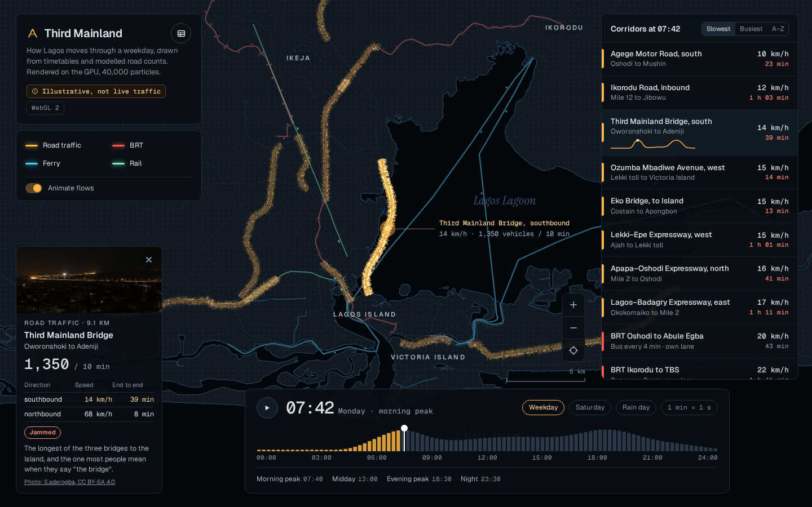
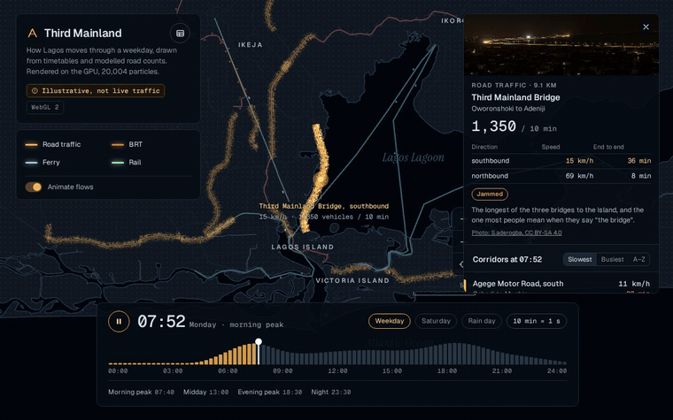
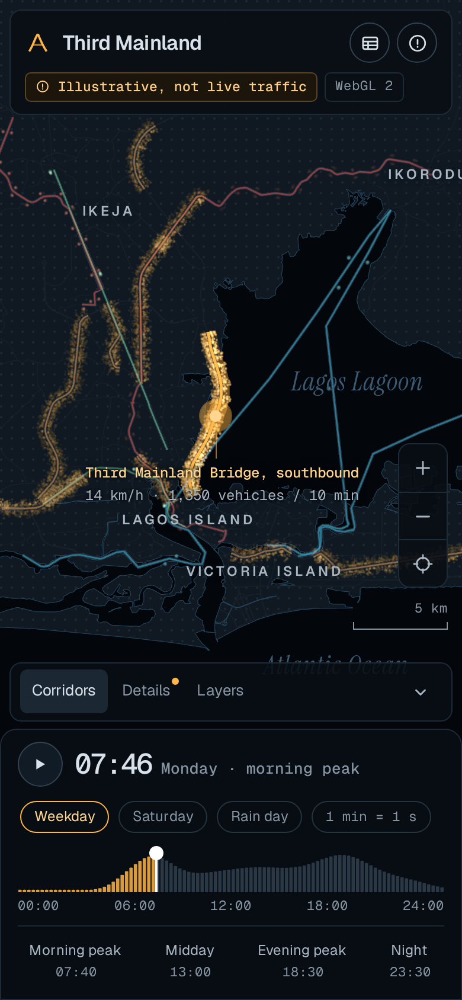
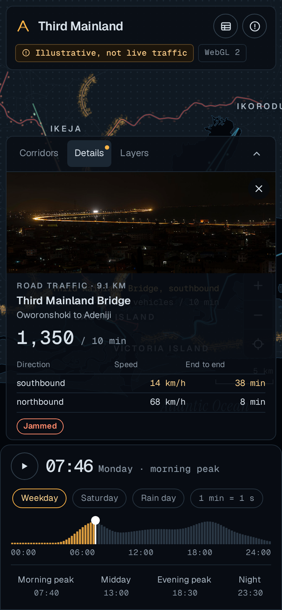
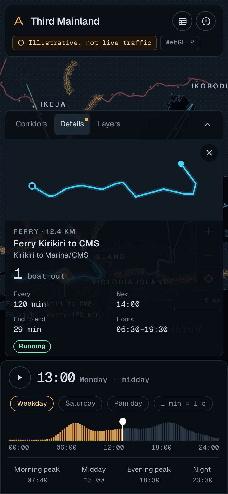
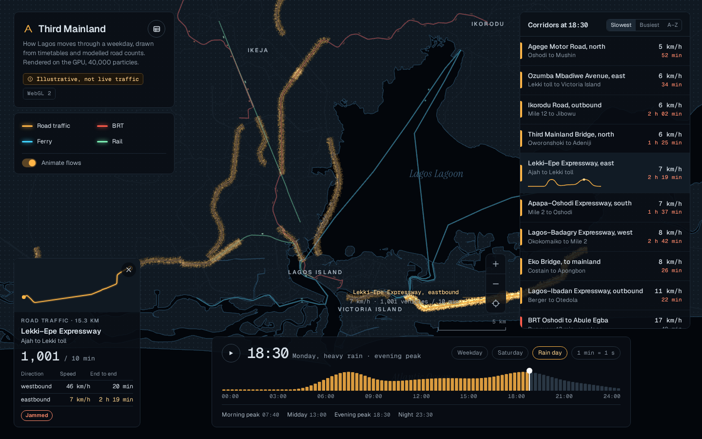
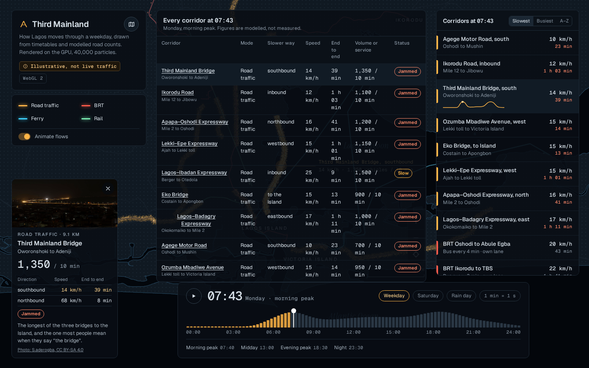

# Third Mainland

**A GPU-rendered night map of how Lagos moves through a day.** Forty thousand particles flow along the city's
real roads, BRT lanes, rail lines and ferry routes, thickening into amber jams on Third Mainland Bridge at
07:40 and thinning out to a trickle at midnight. Scrub the day, switch to a Saturday or a rain day, and every
corridor's speed, journey time and timetable updates with it.

**Live:** [third-mainland.vercel.app](https://third-mainland.vercel.app) · Built by [Emmanuel Balogun](https://github.com/0xEmmo)



<p align="center"></p>

> **Illustrative, not live traffic.** The lines are traced from OpenStreetMap; the flows on them come from a
> hand-tuned model of a Lagos day. The app says so on screen, too.

## What you can do

- **Scrub the day.** Drag the demand histogram, use the arrow keys, or jump to the morning peak, midday,
  evening peak or night. Press play to run the clock at 1 or 10 map minutes per second.
- **Change the kind of day.** Weekday, Saturday (midday market peak, thinner timetables) or a rain day
  (road capacity down, ferries cut back).
- **Read any corridor.** Tap a line on the map, or pick it from the list, to see both directions' speed and
  end-to-end time, vehicles per ten minutes, or headway, next departure and service hours for transit.
  Bridges get a real photo; everything else gets a drawn outline of its route.
- **Filter by mode.** The legend is also the layer switch: road, BRT, ferry and rail.
- **Sort** by slowest, busiest or A–Z, with a speed sparkline for the selected corridor.
- **See it as a table.** Every figure the map shows, in a plain table that works with any screen reader.
- **Pan, pinch, scroll and zoom**, by mouse, touch or keyboard. Station and terminal names show as you zoom in.
- **Install it, then use it offline.** The map, data, photos and fonts are all cached by the service worker.

| Morning peak on a phone           | Corridor details                                | Ferry at midday                               |
| --------------------------------- | ----------------------------------------------- | --------------------------------------------- |
|  |  |  |

| Evening rush in the rain                            | Table view                                           |
| --------------------------------------------------- | ---------------------------------------------------- |
|  |  |

## Stack

- **React 19 + TypeScript + Vite**, no UI kit. Hand-written CSS from the approved mockup.
- **three.js WebGPU renderer with TSL shaders**, which falls back to **WebGL 2** automatically (and again
  if a WebGPU device is lost at start-up). The active backend is shown in the title card.
- **OpenStreetMap via Overpass** for the geometry, processed offline by a small TypeScript pipeline.
- **vite-plugin-pwa / Workbox** for install and offline.
- **Vitest + Testing Library** for unit and component tests, **Playwright + axe-core** end to end at
  390 px and 1440 px. **GitHub Actions** runs lint, format, typecheck, tests, build and e2e.

## How it works

### Data: from OpenStreetMap to a 125 KB file

`scripts/fetch-osm.ts` pulls roads, rail, BRT, ferry ways, water, coastline, place names and stops for a box
around Lagos from the Overpass API (with retries across several public endpoints, because they are busy).
`scripts/build-data.ts` then:

1. **Builds a routing graph** of OSM nodes and ways, honouring one-way streets.
2. **Traces each corridor** through a handful of hand-picked waypoints with Dijkstra, preferring ways with
   the corridor's own name and picking the cheapest combination of candidate nodes near each waypoint
   (dynamic programming), so dual carriageways don't flip sides. If the strict pass fails it relaxes in steps.
3. **Cleans the line:** removes out-and-back spurs, then simplifies with Ramer–Douglas–Peucker.
4. **Assembles water**: stitches multipolygon way fragments into rings, works out holes, and closes the
   Atlantic against the coastline.
5. Writes everything in kilometres from a local origin to `public/data/lagos.json`.

### Model: a believable Lagos day

Each road has a capacity, free-flow speed and morning and evening demand peaks per direction. Speed falls with
demand through the **BPR curve** transport planners use. BRT and rail run on headways; ferries run a daylight
timetable. Scenarios shift the peaks and capacities. It's all pure functions in `src/model`, tested.

### Rendering: 40,000 particles, two tiny textures

Every particle is one instance of a quad. Its corridor, direction, phase and visibility threshold are packed
into instanced attributes once. Each frame the CPU writes only **two numbers per corridor direction** into a
small state texture: how far the flow has advanced and how full the road is. The vertex shader looks the
corridor up in a **path texture** (512 resampled points per line), places the dot on the right-hand side of
the road, and hides it if the road isn't busy enough to need it. Busy roads fade each dot a little so a
jam reads as dense amber rather than burning out to white. Ribbons keep a constant on-screen width at any
zoom. When nothing is moving (paused, or reduced motion) the map only redraws on change.

## Design decisions

- **Dark, quiet base; colour means mode.** Amber road, red BRT, cyan ferry, green rail, on a near-black land
  with a dot grid. Labels are set in Geist, figures in Geist Mono, water in Instrument Serif italic.
- **Honest about being a model.** The "Illustrative" badge opens an explanation of the model and its sources.
- **The table is a first-class view,** not an afterthought, and it becomes the whole app if the GPU can't start.
- **Phones get a bottom sheet**, with the time bar always docked under it, because the time is the main control.
- **Smaller screens move details into the side panel** rather than letting floating cards collide.

## Accessibility

- The canvas is decorative; the map region is a focusable application with keyboard pan (arrows), zoom
  (+ / −), reset (0) and clear (Escape), and a live text summary of the whole city at the current time.
- The time control is a real `slider` with `aria-valuetext` ("07:40, morning peak"), arrow, Page and Home/End keys.
- Scenarios and sorting are native radio groups; layers are toggle buttons; motion is a `switch`.
- Every number is available in the table view. Selections are announced.
- Visible focus everywhere, text contrast checked against WCAG AA, axe runs in the end-to-end tests on both sizes.
- `prefers-reduced-motion` stops the flows and the clock at start (you can still turn them on).

## Edge cases handled

Loading and GPU start-up states · data download failure with retry · damaged or incomplete data · no WebGPU
or WebGL (table takes over) · WebGPU device lost (falls back to WebGL 2) · offline after first visit, with an
indicator · update-available prompt · every layer switched off · transit outside service hours ·
private-mode storage failures · settings restored safely after an app update.

## Run it

```bash
npm install
npm run dev          # http://localhost:5173
npm test             # unit and component tests
npm run e2e          # Playwright, phone + desktop (builds first)
npm run data:fetch   # refresh raw OSM extracts (optional, slow)
npm run data:build   # rebuild public/data/lagos.json from them
```

Add `?renderer=webgl` to force WebGL 2, or `?particles=8000` for a lighter load on slow machines.

## Credits

Map data © OpenStreetMap contributors (ODbL). Photos from Wikimedia Commons under CC BY-SA 4.0 by
S.aderogba and Kaizenify. Full details in [CREDITS.md](CREDITS.md).

## Licence

Code: [MIT](LICENSE). Map data in `public/data/` is a derived database under the ODbL.
